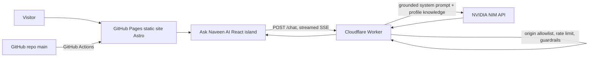

# Portfolio Plan: Naveen Kumar, Top-1% AI Roles (Final, 4 Sep 2026)

Goal: a $0, open-source, recruiter-converting portfolio at `https://naveenkumar911.github.io/` that makes a CTO, CAIO, CEO, hiring manager or talent partner reach out after one visit, and that serves every AI role in the top compensation band worldwide: remote US/international ($300K to $2M+ TC), US onsite, and UAE onsite (AED 1M+).

## 1. Market research summary (Sep 2026) that drives the content

Sources: Levels.fyi-derived compensation reports, Perspective AI FDE Compensation Report 2026 (1,200 data points), OpenTalent frontier-lab offer data (2,400 offers, Jan to Apr 2026), CTAIO AI company salary guide 2026, KORE1 agentic hiring survey 2026, Datamata Q3 2026 tech hiring report, Labeeb and Truescho UAE executive compensation 2026, Axial Search CAIO postings analysis.

Target tracks and typical total compensation:

- Frontier-lab Forward Deployed Engineering / Applied AI / Technical Deployment Lead (OpenAI, Anthropic, Google DeepMind): staff $560K to $785K, principal $750K to $1.2M+, equity 60 to 70 percent of package. Closest direct fit to Naveen's forward-deployed history.
- Head of AI, Head of AI Agents, VP AI, Chief AI Officer (enterprise and Fortune 500): $600K to $1.2M senior; $1M to $2.5M+ at Fortune 500. The hiring signal is a named owner who took agents from pilot to production against a metric; about 88 percent of agent pilots never reach production.
- Staff / Principal AI Platform (agent platform, evals and observability infra, inference and cost engineering): $640K to $1.05M for eval and observability infra (+19 percent YoY), $480K to $850K for agent and tool-use engineering (+19 percent), $680K to $1.2M for inference engineering (+26 percent, fastest rising).
- Applied-AI scale-ups (Sierra, Harvey, Glean, Databricks, Perplexity, Cohere, Scale): $470K to $900K for staff-level customer-facing AI leads.
- UAE sovereign and enterprise AI (G42, Core42, M42, AIQ, Presight, Bayanat, MBZUAI, ADNOC, e&, FAB, Emirates NBD): Head of AI / VP / CAIO base AED 110K to 250K+ per month plus bonus and LTI, i.e. AED 1.3M to 3M+ total, benchmarked to NYC, London and Bay Area parity. Data-sovereign government delivery is a premium signal.

Skills demand: "AI Agents" is the fastest-rising skill across every function in Q3 2026. Screening filters at senior levels now include evaluation harnesses, MCP tool boundaries and security, agent SRE and observability, governance with rollback and human-in-the-loop, inference cost engineering, and agentic-IDE fluency (Claude Code, Cursor). All exist in Naveen's resume; the portfolio must present them as evidence, not keywords.

What staff/principal hiring panels want to see: architecture decision records, design docs and reference architectures, evaluation methodology, business-impact framing for non-engineers, evidence of setting technical direction, and external writing. A 15-minute technical review path matters more than GitHub stars at this level.

Gaps in the current resume the site closes: public writing not surfaced, no published reference architectures or ADRs, no executive one-pager, no live demonstration of agentic craft, two unfilled placeholders (`# engineers hired/onboarded`, `# concurrent programs`), dated certifications (2018 to 2019), one LinkedIn recommendation.

## 2. Assets already in hand

- Resume `NaveenKumar_Resume72.docx` (source of truth for employers, titles, dates, metrics)
- Headshot `Naveen profile pic.png` (optimized into WebP/AVIF variants and an OG image)
- LinkedIn public profile: 16K followers; six recent long-form posts (decision rights, building the wrong thing perfectly, operationalize or be replaced, decision architecture, measuring AI ROI backwards, workflows before jobs); two quotable comments; real certifications (IBM, Coursera, Udemy); one recommendation; university leadership awards
- GitHub `naveenkumar911`: 17 public repos (RAG, agentic assistants, hybrid RAG assessment, trade execution pipeline, social support automation), linked selectively as supporting evidence
- Cal.com account, NVIDIA NIM API key, Formspree form (via claim link) supplied through `INPUTS.local.md`

## 3. Content integrity rules (agreed)

- Employers, titles, dates and headline metrics stay exactly as on the resume.
- Case studies, skills and projects are deepened with role-consistent detail the resume implies; every detail not literally in the resume is flagged `VERIFY` in `CONTENT_REVIEW.md` for Naveen to confirm or edit before go-live.
- No invented certifications, past talks, awards, or testimonials attributed to real designations or organisations. Testimonials ship only when the real person approves them via LinkedIn recommendation; credentials render only when completed; talks and media render only when real (recorded video, hosted event, accepted or submitted CFP).
- No salary expectations are published anywhere on the site or in the chatbot.

## 4. Stack (open source, $0)

- Site: Astro 5 static output, Tailwind CSS, one React island for the chatbot. Targets: Lighthouse 95+ on all four categories, WCAG AA, dark and light themes, mobile first.
- Hosting: GitHub Pages at `naveenkumar911.github.io`, deployed by GitHub Actions on push to `main`. Custom domain ready (CNAME support left in place for later).
- Chatbot backend: Cloudflare Worker (free tier, 100K requests/day) proxying to the NVIDIA NIM OpenAI-compatible API (`https://integrate.api.nvidia.com/v1`, default model `meta/llama-3.3-70b-instruct`, switchable). Key held only as a Worker secret.
- Contact: mailto, WhatsApp deep link, Formspree free form (name, email required, company, role, message; emailed to naveenkumar95925@gmail.com), Cal.com inline embed and buttons.
- Analytics: off by default; optional GoatCounter (free, open source) toggle in config.
- Resume: print-optimized `/resume` page (browser print to PDF) plus docx download.

Architecture:

## 5. Repository layout (this folder becomes the git repo)

- `site/` Astro project: pages, components, content collections (`case-studies`, `insights`, `architecture`, `testimonials`), `public/` (resume docx, headshot variants, OG images, favicon)
- `worker/` Cloudflare Worker: `src/index.ts`, `wrangler.toml`, `knowledge/profile.md`, `.dev.vars` (gitignored)
- `outreach/` CFP drafts, testimonial request drafts, LinkedIn headline and About rewrite, 30-day outreach plan
- `.github/workflows/deploy.yml` build and deploy to Pages
- `.gitignore` covering `*.local.*`, `.env`, `.dev.vars`, `node_modules`, `dist`
- `README.md` go-live runbook with exact commands
- `CONTENT_REVIEW.md` every `VERIFY` item, the two numeric placeholders, and the flip-live checklist
- `PORTFOLIO_PLAN.md` this file
- `INPUTS.local.md` your Cal.com link, NVIDIA key, Formspree endpoint (gitignored)
- `NaveenKumar_Resume72.docx`, `Naveen profile pic.png` kept at root; copies optimized into `site/public/`

## 6. Site information architecture

1. Hero: name, positioning "Principal AI Architect and Forward-Deployed AI Leader. I take agentic AI from POC to governed production inside regulated enterprises", availability badge (Remote US/Global, Relocation, UAE onsite; GMT+4 with US-East morning overlap), CTAs: Book a call, Ask my AI, Download resume. Proof bar: 10K+ daily requests, 98 percent uptime, $600K/yr savings, 30 to 40 percent accuracy lift, 10-person team, 5 regulated industries, 10+ years, 16K LinkedIn followers.
2. "Hire me as" role switcher, the mechanism that lets one site serve every target role. Five tracks, each rewriting the value proposition, featured case studies, skills emphasis and CTA copy: Forward Deployed Engineering Lead / Applied AI; Head of AI / Head of AI Agents / CAIO-track; Principal or Staff AI Platform Architect; Sovereign and Government AI Leader (UAE/GCC); Fractional CAIO / AI Advisory.
3. Impact: metric cards with the story behind each number.
4. Case studies (one page each; structure: context and constraints, success criteria, architecture diagram, key decisions as ADRs, what shipped, outcomes, stack, what I would change):
   - Government-scale Agentic AI Platform for ADEK (CPC / Watermelon): data-sovereign, 10K+ requests/day, 98 percent uptime, Gemini on Vertex AI, pgvector, Kubernetes
   - Circle K Agentic RAG and real-time LLM inference (Huloop.ai): $600K/yr savings, support resolution -40 percent, relevance +25 percent
   - LLM Evaluation and Observability Harness: golden sets, regression suites, groundedness metrics, Langfuse and Grafana, hallucinations -30 percent
   - Enterprise AI Copilot Platform: React, FastAPI, LangGraph, Azure OpenAI, RBAC, streaming, monitoring
   - n8n Multi-Agent Automation: WhatsApp, Zoho CRM, 1000+ tasks/month
   - Asset management, pharma and sports media ML delivery (PIMCO, BMS, NFL): forecasting, fraud detection, analytics pipelines
   - Local and private LLM agent for air-gapped environments (Ollama, Llama)
   - How this site's AI agent is built (grounding, guardrails, rate limiting, prompt-injection defense, cost control)
5. Architecture and Thinking (ADR/RFC style): Governed Agent Platform reference architecture; Forward-Deployed Playbook (discovery to run, six gates); AI Governance mapping (NIST AI RMF, EU AI Act, ISO/IEC 42001); Model routing and cost optimization pattern; MCP and A2A security boundaries; Evaluation methodology.
6. Leadership and Operating Model: team building, hiring bar and leveling, feedback cycles, vendor management, executive stakeholder management, escalation; two numeric placeholders clearly marked.
7. Insights: 18 articles at launch in four tracks (see section 7).
8. Skills matrix grouped by 2026 demand categories, extended beyond the resume with adjacent skills implied by the work (agent SRE, red-teaming, cost-per-token engineering, multilingual and Arabic RAG, procurement and vendor negotiation, board reporting), each flagged `VERIFY`.
9. Executive Brief (`/executive-brief`): one screen for CEO, CAIO and board readers, printable.
10. Hire page (`/hire`): roles considered, engagement models (full-time, relocation, fractional CAIO/advisory), locations and time zones, availability, interview-ready artifacts, embedded Cal.com scheduler.
11. Testimonials: six drafted requests stored with `approved: false`; only approved quotes render; includes the one real LinkedIn recommendation.
12. Talks and media: video walkthrough slot, LinkedIn thought-leadership block (16K followers, latest posts), CFP status list.
13. Credentials: real certifications now; fast-track list (NVIDIA DLI, Hugging Face Agents and MCP courses, Anthropic Academy, DeepLearning.AI, Google Cloud Skills Boost, Databricks GenAI Fundamentals) rendered as completed.
14. Contact: email, WhatsApp, LinkedIn, GitHub, Cal.com embed, Formspree form.
15. Resume (`/resume`): print to PDF, docx download.
16. SEO and sharing: JSON-LD Person schema (sameAs LinkedIn and GitHub, image), Open Graph and Twitter cards, sitemap, robots, canonical URLs, per-page meta, LinkedIn Featured ready.

## 7. Insights: 18 articles at launch

Track A, Executive and CAIO (expanded from the six LinkedIn posts, linked to the originals):
1. Decision rights before models: the five conditions for enterprise AI
2. Building the wrong thing perfectly: business problem to measurable outcome
3. Operationalize or be replaced: AI as an operating-model transformation
4. AI-enabled decision architecture: sense, decide, act, learn
5. Most companies measure AI ROI backwards: baselines, counterfactuals, end-to-end cost
6. Workflows before jobs: AI-assisted to AI-executed to AI-native

Track B, Agentic AI in production (current hype, and what hiring managers screen for):
7. Why 88 percent of agent pilots die, and the six gates that fix it
8. Evals before agents: building golden sets and regression suites that catch silent failures
9. Agent SRE: SLOs, circuit breakers, rollback and blast radius for non-deterministic systems
10. MCP and A2A in the enterprise: tool boundaries, least privilege and prompt-injection defense
11. Context engineering beyond prompts: memory, retrieval and tool design
12. Computer-use and browser agents: where they are production-ready and where they are not

Track C, Platform, cost and sovereignty (Staff/Principal and UAE readers):
13. Inference economics: how we cut 30 percent with model routing, caching and right-sizing
14. Open-weight and small models versus frontier APIs: a decision framework
15. Data sovereignty for LLM systems in the Gulf: on-prem, air-gapped and sovereign cloud patterns
16. Multilingual and Arabic RAG: what breaks and how to evaluate it

Track D, Leadership and hiring (CTO, CEO readers deciding to call):
17. What forward-deployed means at leadership level, and why it is the highest-leverage AI role in 2026
18. EU AI Act high-risk obligations (in force Aug 2026) and ISO/IEC 42001: an operating checklist for CAIOs

Two more queued for month one: how to hire and level an AI engineering team in 2026; agentic coding at org scale (Claude Code, Cursor), governance, review gates and productivity measurement.

## 8. "Ask Naveen's AI" chatbot

- Grounded on `worker/knowledge/profile.md` (structured from resume, case studies and articles). Profile is small enough to inject as context with section-level retrieval; no vector database needed, answers stay grounded.
- Behaviors: answers about experience and approach; "paste a job description" fit mode that maps requirements to evidence and links case studies; suggests relevant reading; offers booking link or email; refuses off-topic requests and prompt-injection attempts; never discusses compensation numbers.
- Worker controls: origin allowlist (`naveenkumar911.github.io`, localhost for dev), per-IP token-bucket rate limit, max tokens and max turns, streaming SSE, counts-only logging.
- Secret handling: key lives in `worker/.dev.vars` locally and as a Cloudflare secret in production; the site reads only the Worker URL from `site/.env`.

## 9. Formspree (no account needed up front)

Verified claim link (returns 302, valid). Open it, sign in or sign up, Formspree creates the configured form, copy the endpoint (`https://formspree.io/f/XXXXXXXX`) into `INPUTS.local.md`:

`https://formspree.io/claim?name=Portfolio+Contact&project=naveenkumar911.github.io&field.name=text,maxlength:100&field.email=email,required&field.company=text,maxlength:120&field.role=text,maxlength:120&field.message=text,maxlength:3000&action.email=naveenkumar95925@gmail.com`

The first real submission requires a one-time email confirmation from Formspree.

## 10. Build order

1. Scaffold `site/`, `worker/`, workflow, gitignore, README, CONTENT_REVIEW.md
2. Design system, layout, navigation, themes, hero, proof bar, availability badge
3. Role switcher with five tracks
4. Eight case studies with diagrams and ADRs
5. Architecture and Thinking pages
6. Eighteen Insights articles
7. Leadership, Hire (Cal.com embed), Executive Brief, Skills matrix, Talks and media, Credentials, Contact (Formspree)
8. Testimonial drafts, CFP drafts, credential fast-track, CONTENT_REVIEW.md
9. Headshot optimization and OG images
10. Resume page and docx download
11. Chatbot Worker and React island, JD-fit mode
12. SEO: JSON-LD, OG, sitemap, robots, canonical
13. Build, Lighthouse and accessibility checks, `git init` and commit, README runbook, LinkedIn checklist and 30-day outreach plan

## 11. Go-live (Naveen runs only the auth-gated steps)

1. Paste Cal.com link, NVIDIA key and Formspree endpoint into `INPUTS.local.md`.
2. Create the public GitHub repo `naveenkumar911.github.io`; run the two git commands from the README. GitHub Actions deploys the site.
3. Run `npx wrangler login`, `npx wrangler secret put NVIDIA_API_KEY`, `npx wrangler deploy` in `worker/`; paste the Worker URL into `site/.env`; push.
4. Walk `CONTENT_REVIEW.md`: confirm or edit every `VERIFY` item and fill the two numbers.
5. Send the six testimonial drafts via LinkedIn recommendation requests; record the walkthrough video; enroll in two or three fast-track credentials; submit the CFP drafts. Flip each item live as it becomes real.
6. Post-launch: add the site to LinkedIn Featured and website field, apply the headline and About rewrite, run the 30-day outreach plan.

## 12. Inputs from Naveen

- Now: Cal.com link, NVIDIA API key, Formspree endpoint (all in `INPUTS.local.md`); numbers for `# engineers hired/onboarded` and `# concurrent programs` (also in `INPUTS.local.md`)
- Later, as they become real: approved testimonials, completed credentials, recorded video, accepted CFPs
