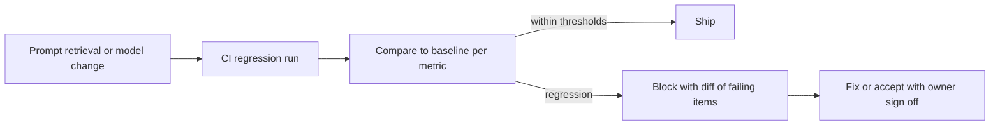

## Principles

1. **Quality is a number the business owner recognises.** If the Director and the engineer disagree about what "accurate" means, the golden set is wrong, not the model.
2. **Evaluate the system, not the model.** Retrieval, prompts, tools, routing and guardrails all change outcomes. Model benchmarks tell you almost nothing about your system.
3. **Gates, not dashboards.** A metric nobody is blocked by is decoration.
4. **Cost and latency are quality dimensions.** A correct answer that is too slow or too expensive fails.
5. **Production is the best test set.** Sample traces continuously and promote them into golden sets.

## Metric layers

| Layer | Metrics | Method |
| --- | --- | --- |
| Retrieval | recall at k, precision at k, MRR, coverage of required citations | Deterministic against labelled chunks |
| Generation | groundedness, faithfulness, relevance, completeness, hallucination rate | Calibrated LLM-as-judge plus human sample |
| Agent behaviour | tool selection accuracy, argument correctness, step efficiency, end-state task success, unsafe action attempts | Trace assertions and simulated environments |
| Safety | injection resistance, PII leakage, policy refusals, jailbreak suite pass rate | Adversarial test sets |
| Operations | p50/p95 latency, cost per request, error rate, timeout rate | Production telemetry |

## Golden sets

- Built with the business owner. Each item: input, context snapshot or retrieval expectation, expected answer or action, required citations, difficulty and category tags.
- Hundreds of items per workflow are enough to start; breadth across categories matters more than count.
- Versioned in the repository beside the workflow code.
- Refreshed from sampled production traces every week; retired items are archived, not deleted.

## Calibrated judges

- Judge rubric written per metric, with examples of pass and fail.
- Validate judge against a human-labelled subset; iterate until agreement is acceptable for the decision the metric drives.
- Version judge prompts and models; re-validate when either changes.
- Use pairwise comparison for "which is better" decisions and absolute scoring for gates.

## Release gate

Thresholds are per workflow and per metric. Some metrics are hard gates (hallucination rate, unsafe action attempts); others are soft with owner sign-off.

## Production sampling

- Sample traces stratified by workflow, outcome and user feedback.
- Weekly review with the business owner: promote to golden set, fix, or accept.
- Track drift in input distribution, retrieval hit rates and judge scores; alert on shifts.

## Anti-patterns I refuse

- Reporting a single "accuracy" number without saying what was measured.
- Using an uncalibrated judge to make ship decisions.
- Evaluating on the vendor's benchmark.
- Treating evaluation as a phase rather than a permanent part of the pipeline.

See the [evaluation harness case study](/case-studies/llm-evaluation-harness) for the implementation and outcomes.
