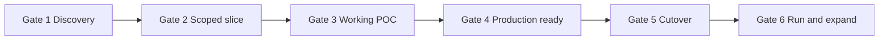

## Why gates

About 88 percent of agent pilots never reach production. The failures are rarely technical. They are missing owners, unmeasured baselines, unscoped autonomy, and handovers that never happened. Gates make those failures visible early, when they are cheap.

## Gate 1: Discovery

- **Activities**: workshops with business owners, operators and engineering; process walk-throughs; data and system access mapping; risk and residency constraints.
- **Artifact**: ranked use-case list with baseline metric, accountable owner, success criterion and blast-radius class per use case.
- **Exit**: an executive sponsor signs the success criteria for the first slice. If nobody will own the outcome, we stop here.

## Gate 2: Scoped slice

- **Activities**: choose the highest value, lowest blast radius slice; define the golden set with the business owner; agree the architecture within the [reference architecture](/architecture/governed-agent-platform); write the first ADRs.
- **Artifact**: one-page scope, golden set v1, architecture sketch, ADRs, timeline in weeks.
- **Exit**: golden set exists and the owner agrees it represents the job.

## Gate 3: Working POC

- **Activities**: build the slice end to end with real data in a controlled environment; run the golden set; log every failure mode.
- **Artifact**: demo on real data, evaluation report against the success criterion, failure-mode list.
- **Exit**: the metric moves in the right direction on the golden set, and failure modes have mitigation plans. Not "the demo looked good".

## Gate 4: Production ready

- **Activities**: security and residency review; guardrails and injection defense; tracing, SLOs and alerts; regression suite in CI as a release gate; runbooks; cost model.
- **Artifact**: production readiness review signed by security, operations and the business owner.
- **Exit**: every item on the readiness checklist is green, or has an accepted risk with a named owner and date.

## Gate 5: Cutover

- **Activities**: staged rollout by cohort; shadow mode where writes are involved; on-call rotation; daily quality review for the first two weeks.
- **Artifact**: rollout plan, incident log, first production evaluation report against the baseline.
- **Exit**: baseline metric improves in production, no open severity-one incidents, business owner confirms adoption.

## Gate 6: Run and expand

- **Activities**: weekly trace sampling into the golden set; monthly cost and quality review; expansion candidates re-enter at Gate 2; field learnings fed back to product.
- **Artifact**: operating review pack; expansion backlog; product feedback log.
- **Exit**: never. This is the operating model.

## What forward-deployed means at leadership level

At the individual level, forward deployment is embedding with the customer and writing production code. At leadership level it is owning the whole gate sequence across many engagements at once, hiring people who can run it, being the escalation point when a gate is at risk, and making the field-to-product loop real. I describe that shift in [what forward-deployed means at leadership level](/insights/what-forward-deployed-means-at-leadership-level).
