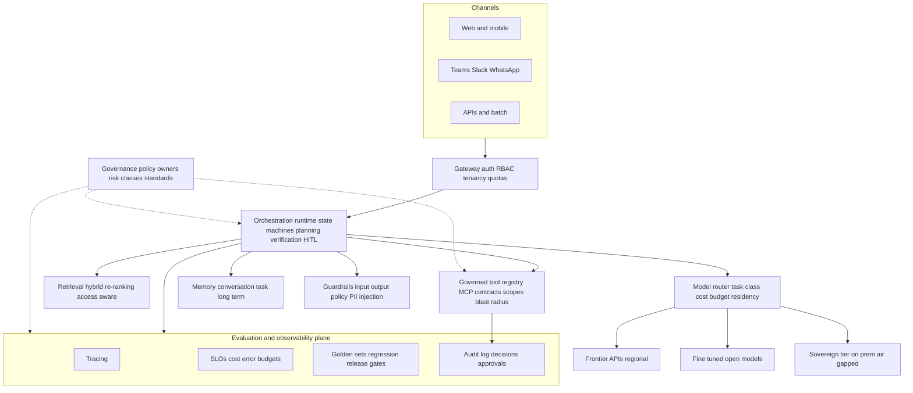

## Purpose

Most enterprise agent programs stall between pilot and production because the agent was built, but the platform around it was not. This reference architecture separates what changes per use case (prompts, tools, golden sets) from what must be built once and governed (runtime, security, evaluation, observability, cost).

## Layers

## Component responsibilities

| Layer | Owns | Does not own |
| --- | --- | --- |
| Gateway | Identity, RBAC, tenancy, quotas, request shaping | Business logic |
| Orchestration runtime | Workflow state, planning, tool dispatch, verification, human approval | Tool implementations |
| Governed tool registry | Tool contracts, permission scopes, blast-radius class, versioning | Agent reasoning |
| Retrieval | Ingestion, chunking, indexing, hybrid search, re-ranking, ACL filtering | Which documents are authoritative (business owns) |
| Model router | Model selection by task class, cost budget, residency tag; caching; fallbacks | Prompt content |
| Memory | Conversation, task and long-term memory with scoping and retention | Retrieval of documents |
| Guardrails | Input and output policy, PII handling, injection defense, refusal behaviour | Evaluation of quality |
| Evaluation and observability plane | Tracing, SLOs, cost, golden sets, regression gates, audit | Fixing what it finds (teams own) |
| Governance | Risk classes, standards, owners, intervention rights | Day-to-day operation |

## Non-functional requirements I set by default

- Every agent action is attributable: who asked, which model, which tools, which data, who approved.
- Every tool declares a blast-radius class; irreversible actions require approval until a documented track record justifies relaxing it.
- Every workflow has a golden set and a release gate before it serves real users.
- Residency-tagged workloads never leave the sovereign tier.
- Cost per request and latency percentiles are SLOs with owners.

## Adoption path

1. Stand up gateway, runtime, one tool, one retrieval source, tracing and one golden set. Ship one workflow.
2. Add the router with two models and a cost budget. Add the release gate.
3. Add the sovereign tier if residency demands it. Add memory.
4. Open the platform to product teams with a template repository and review gates.

## Related

- [Forward-Deployed Playbook](/architecture/forward-deployed-playbook)
- [Evaluation methodology](/architecture/evaluation-methodology)
- [MCP and A2A security boundaries](/architecture/mcp-a2a-security-boundaries)
- [Model routing and cost optimization](/architecture/model-routing-and-cost-optimization)
