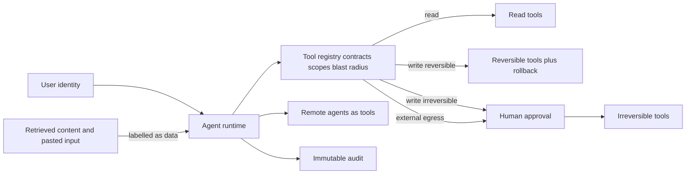

## Context

Model Context Protocol (MCP) standardises how models call tools; Agent-to-Agent (A2A) protocols standardise how agents delegate. Both make it easy to connect an agent to anything. Ease is the risk. Without boundaries, a single prompt injection in a retrieved document can become a write to a production system.

## Decision

Agents may only call tools registered in the governed tool registry, under the following rules.

### Tool contracts

- Every tool has a typed contract (inputs, outputs, side effects), an owner and a version.
- Contracts declare a **blast-radius class**: `read`, `write-reversible`, `write-irreversible`, `external-egress`.
- Contracts declare required **scopes**; the agent runtime intersects the caller's scopes with the tool's requirements.

### Identity and least privilege

- The end user's identity propagates through the agent to the tool. Tools never run as a service account with broader rights than the user.
- Agents receive the minimum tool set for the workflow; tool availability is per workflow, not global.
- Secrets are injected by the runtime, never visible to the model.

### Approval by blast radius

| Class | Default policy |
| --- | --- |
| read | Allowed, logged |
| write-reversible | Allowed with rollback path recorded; sampled review |
| write-irreversible | Human approval required |
| external-egress | Human approval required; content policy applied |

Policies relax only with a documented track record per tool and sign-off from the owner.

### Injection defense

- Retrieved documents, tool outputs and user-pasted content are **data**, wrapped and labelled as such in the prompt.
- Instructions found inside data are treated as text to analyse, never executed.
- Tool calls are validated against the contract before dispatch; arguments derived from untrusted content are checked against allowlists where possible.
- The runtime reasserts system instructions after untrusted content and monitors for instruction-override patterns.

### Agent-to-agent delegation

- Delegation goes through the same registry: a remote agent is a tool with a contract and a blast-radius class.
- Identity and scopes propagate; a delegate cannot exceed the caller's rights.
- Delegation depth is capped; every hop is traced.

### Audit

- Every tool call records: user, workflow, agent step, tool version, arguments hash, result class, approver if any.
- Audit records are immutable and queryable by security and internal audit.

## Consequences

- Security teams approve autonomy per tool class rather than debating "agents yes or no".
- Adding a tool is a registry change with an owner, not a prompt edit.
- Injection incidents are contained to the read class by default.
- Some latency and friction for irreversible actions; accepted.

## Related

[MCP and A2A in the enterprise](/insights/mcp-a2a-enterprise-security-boundaries) explains the reasoning for non-security readers; the [governed agent platform](/architecture/governed-agent-platform) shows where the registry sits.
