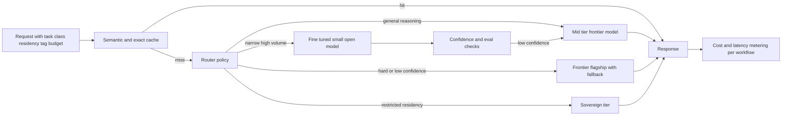

## Context

Inference is now the dominant AI cost centre. Teams default to the most capable model for every call, then discover the bill. The fix is architectural, not a procurement negotiation.

## Decision

Introduce a **model router** in front of all inference with four levers, and make cost per request a release-gated SLO.

### Lever 1: Route by task class

Classify requests into task classes (extraction, classification, routing, grounded Q&A, open reasoning, generation). Map each class to the cheapest model that passes the golden set for that class. Escalate on low confidence.

### Lever 2: Cache

Exact-match caching for repeated queries; semantic caching for near-duplicates with a similarity threshold validated against the golden set; prompt caching for long stable system prompts and retrieved context where the provider supports it.

### Lever 3: Right-size with fine-tuning

LoRA/QLoRA fine-tuned open models for the high-volume, narrow classes. Fine-tuning cost is recovered within weeks at production volume. Quality is proven on the class golden set before routing traffic.

### Lever 4: Trim the context

Chunking and re-ranking tuned so fewer, better chunks reach the model. Conversation memory summarised. Tool outputs truncated to what the step needs.

### Cost as an SLO

Cost per request per workflow is metered, budgeted and part of the release gate. A "better model" change that breaks the budget fails the gate like a quality regression would.

## Consequences

- About 30% infrastructure savings on the government platform; predictable latency; no measured quality loss.
- Added complexity in the router and cache layers; mitigated by making both observable and by keeping policies declarative.
- Requires golden sets per task class; this was already required by the [evaluation methodology](/architecture/evaluation-methodology).

## Related

[Inference economics](/insights/inference-economics-cutting-30-percent) walks through the numbers and the order in which to pull the levers.
