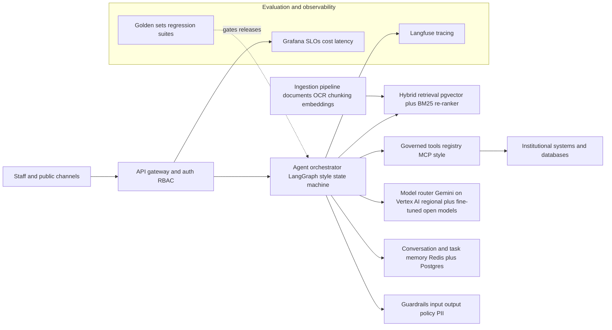

## Context

A government education entity needed to move from scattered chatbot pilots to a single, governed agentic AI capability serving staff and the public. The environment is data-sovereign: personal and institutional data cannot leave the country, vendor access must be governed, and every model decision has to be explainable to Directors who own the outcomes.

I joined as the AI lead with a mandate to set architecture direction, build the team, and ship. I chose to build the first production slice myself so the guardrails I set were grounded in the real system rather than in slides.

## Success criteria agreed before build

- Serve staff and public queries with grounded answers over policy, procedures and institutional documents, with citations.
- Automate multi-step workflows (case triage, document intelligence, structured data lookups) with human approval at defined blast-radius thresholds.
- Meet residency constraints: all data, embeddings, logs and inference within the approved region; no cross-border calls.
- Operate at 99%-class reliability with measurable quality: groundedness, hallucination rate, latency, cost per request.
- Reduce operating cost of the existing manual and legacy processes by a target of 25%.

## Architecture

All services run as containerized microservices on Kubernetes in-region. Ingestion, retrieval, inference, evaluation and monitoring are separate services with their own SLOs.

## Key decisions (ADR summaries)

**ADR-01: Regional managed models plus fine-tuned open models, behind a router.** Gemini on Vertex AI in the approved region for general reasoning; LoRA/QLoRA fine-tuned open-weight models for high-volume, narrow tasks (classification, extraction, routing) where cost and latency mattered more than breadth. The router selects by task class, confidence and cost budget. Result: about 30% lower inference spend and predictable latency.

**ADR-02: pgvector over a dedicated vector database.** The team already ran PostgreSQL; adding pgvector kept one operational surface, one backup and residency story, and let us join embeddings with relational metadata for access control at query time. We accepted a ceiling on raw ANN throughput that we have not hit at current scale.

**ADR-03: Agent actions gated by blast radius.** Every tool in the registry declares a blast-radius class (read, write-reversible, write-irreversible). Irreversible actions require human approval; reversible writes log a rollback path. This let Directors approve autonomy incrementally instead of debating "AI yes or no".

**ADR-04: Evaluation is a release gate, not a dashboard.** Golden datasets per workflow, regression suites in CI, and groundedness and hallucination thresholds that block deployment. This is what made the 30-40% accuracy gains stick across model and prompt changes.

**ADR-05: Build with agentic development tooling, review as if it were not.** Claude Code and Google Antigravity accelerated delivery of the platform; design and code review gates, ADRs and test coverage requirements stayed mandatory. Velocity came with an audit trail.

## What shipped

- Production agentic platform with grounded Q&A, agentic workflows and RAG assistants across multiple departments.
- Ingestion pipeline with OCR, document intelligence, chunking strategy per document type, and access-aware indexing.
- Governed tool registry with MCP-style contracts, permission scopes and blast-radius classes.
- Evaluation and observability harness: Langfuse tracing, Grafana SLO dashboards, golden sets, nightly regression runs, cost per request tracking.
- Runbooks, on-call rotation, incident response and release management operating model.
- AI governance standards: responsible AI, prompt governance, model evaluation, security and deployment standards adopted across the entity.

## Outcomes

- 10K+ requests per day for thousands of users at 98% uptime.
- User engagement up 40%; operating cost of covered processes down about 30%.
- Latency down 40% after the microservices split, caching and routing.
- Answer accuracy up 30-40% and hallucinations down about 30% through the evaluation harness, fine-tuning and context engineering.
- Infrastructure cost down 30% through model routing, caching and right-sizing.

## Leadership dimension

Built the team from a handful of engineers to 10 (hired 8, onboarded 12 including partner staff), set the hiring bar, ran feedback cycles and career development, and acted as the senior escalation point for 12 programs with up to 6 running concurrently. Managed vendors and implementation partners across architecture reviews, milestones and operational handover.

## What I would do differently

Start the evaluation harness on day one rather than week six; the first month of prompt changes had no regression safety net. Invest earlier in Arabic-language retrieval evaluation, which turned out to need its own golden set and re-ranker tuning.
