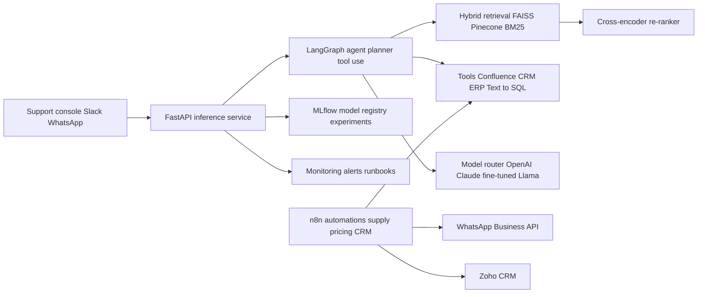

## Context

A large convenience retailer had knowledge scattered across Confluence, operational manuals, CRM and ERP data, and a support function absorbing repetitive questions from stores and internal teams. Several teams had run GenAI demos; none had reached production. Huloop.ai brought me in as the embedded architect and engineer to own the path from discovery to production.

## Forward-deployed approach

1. **Discovery workshops** with store operations, support, supply chain and finance. Output: a ranked list of use cases with a baseline metric, an owner and a success criterion each.
2. **Scope the first slice** to the highest-value, lowest-blast-radius problem: grounded answers over operational documentation for the support function, measured on resolution time and answer relevance.
3. **Build the POC myself in two weeks**, then harden with the client's engineers so they could own it.
4. **Production cutover** with CI/CD, monitoring, runbooks and a handover plan. Only then expand to agentic workflows.

## Architecture

## Key decisions

**Hybrid retrieval with re-ranking before any model upgrade.** The first accuracy jump came from retrieval quality, not from a bigger model: dense plus lexical retrieval, metadata filters, and a cross-encoder re-ranker lifted answer relevance 25% on the golden set.

**Fine-tune and right-size where volume is high.** PEFT/LoRA/QLoRA fine-tuned Llama models handled classification, extraction and routing at a fraction of frontier-API cost. Frontier models were reserved for open-ended reasoning. Inference cost fell while quality held.

**Agentic RAG only after grounded RAG was stable.** Tool-augmented agents (web search, calculators, internal APIs, text-to-SQL) were added once retrieval, evals and monitoring were in place, so agent failures were diagnosable.

**Automation through n8n for ops workflows.** Multi-step agent workflows integrated WhatsApp, Zoho CRM and external APIs with LLM-based extraction and decisions, retries, error handling and monitoring; automated supply chain and pricing operations at more than 1,000 tasks per month.

## What shipped

- Production agentic RAG assistant over Confluence and operational documentation with citations.
- Real-time LLM inference services on FastAPI with MLflow-backed model management, CI/CD, monitoring and runbooks.
- Retail text-to-SQL assistant for self-service analytics over retail data.
- n8n agent automations for supply chain, pricing and CRM operations.
- Fine-tuned, right-sized models for high-volume tasks.

## Outcomes

- $2M per year in cost savings across support deflection, operations automation and inference cost reduction.
- Support resolution time down 40%; answer relevance up 25%.
- A client engineering team able to run and extend the platform after handover.

## What this taught me about forward deployment

The engagement succeeded because success criteria were agreed before a line of code, the first slice was small enough to ship in weeks, and handover was designed in from the start. Those three practices became the backbone of the six-gate playbook I use today.
