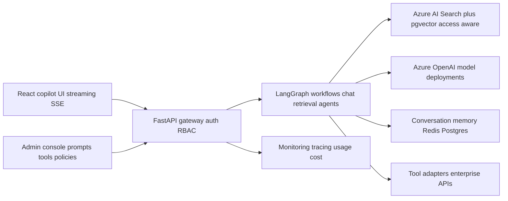

## Problem

Every new AI use case was being built as a one-off chatbot with its own auth, its own retrieval and no monitoring. Leadership wanted one platform that product teams could build on, with security and observability handled once.

## Architecture

## Key capabilities

- **Streaming responses** over server-sent events with token-level rendering and tool-call status, so users see progress instead of a spinner.
- **Conversational memory** with summarisation and per-user, per-workspace scoping stored in Redis (hot) and PostgreSQL (durable).
- **Access-aware retrieval**: documents carry ACLs at index time; retrieval filters by the caller's roles before ranking, so RBAC is enforced in the data path rather than in the prompt.
- **Agent workflows** as LangGraph state machines with explicit nodes for planning, tool use, verification and human approval.
- **Admin console** for prompt versions, tool registration, policy toggles and usage reporting.
- **Production monitoring**: request tracing, token and cost accounting per team, latency SLOs, error alerting.

## Decisions

**Enforce authorization in retrieval, not in prompts.** Prompt-level "do not reveal" instructions are not a security control. ACL filtering at query time is.

**Workflows as explicit state machines.** Free-form agent loops were hard to debug and impossible to explain to security reviewers. LangGraph graphs made every path inspectable and testable.

**Platform team owns the runtime; product teams own prompts and tools.** This division let several teams ship copilots without re-solving auth, memory, streaming or monitoring.

## Outcome

The platform became the template for later agentic deployments, including the government platform, where the same separation of runtime, tools and governance carried over. It cut the time from "approved use case" to "in users' hands" from months to weeks.
