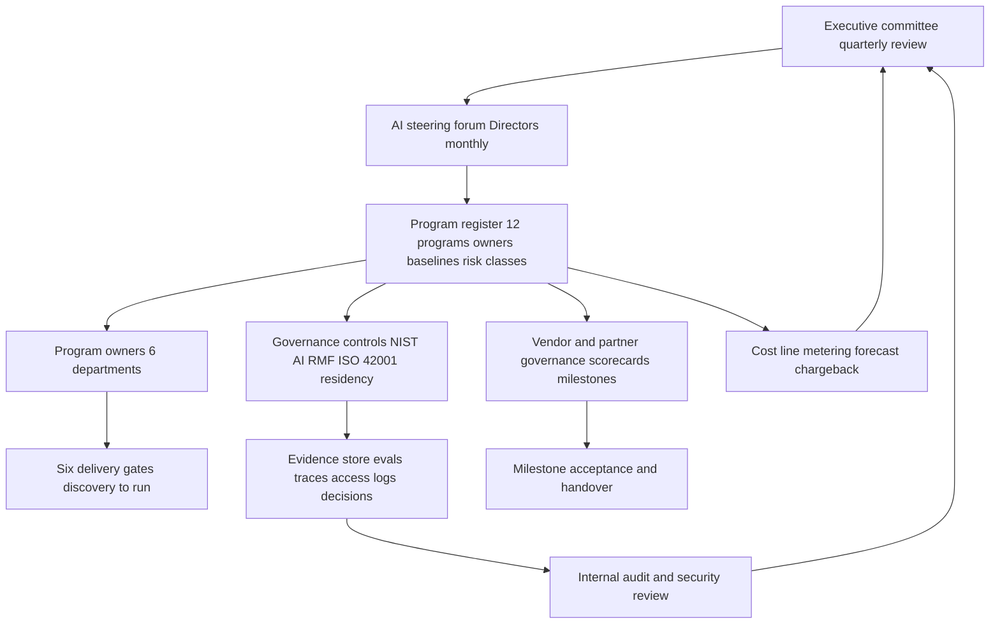

## Why this case study exists

Most AI case studies describe a system. Enterprise hiring committees, boards and procurement teams want to know something else: can this person run AI as a **business function** inside a regulated organisation, with auditors, vendors, competing departments and a budget line? This is the operating-model side of the same engagement described in [the platform case study](/case-studies/adek-agentic-platform).

## Context

Within months of the platform going live, requests arrived from every direction: departments wanted their own assistants, a partner proposed an off-the-shelf product, security wanted to know where the embeddings lived, finance wanted a cost forecast, and Directors wanted to know which of the dozen initiatives would actually produce a result they could report upward.

Left alone, this becomes twelve pilots, three vendors, no shared standards and a cost line nobody owns. My mandate expanded from "build the platform" to "run AI as a governed portfolio for the entity".

## Success criteria agreed with the sponsor

- Every AI initiative registered with a named business owner, a baseline, a success metric and a risk class. No unregistered pilots.
- Compliance demonstrable to auditors: residency, access, model decisions and evaluation evidence retrievable on demand, mapped to a recognised framework.
- Vendors and implementation partners managed to written acceptance criteria and measured outcomes, not to invoices.
- One steering forum where departments prioritise together, so the portfolio is sequenced by value rather than by who asked loudest.
- A single cost line for AI infrastructure and vendors, forecast quarterly, with a reduction target of 25%.

## Operating model

### 1. Regulated-industry compliance, implemented in software

The entity operates under strict data-residency requirements and public-sector accountability. Rather than a policy document, compliance was built into the platform and the process:

- **Control mapping.** Every program is assessed against NIST AI RMF functions (Govern, Map, Measure, Manage) and the ISO/IEC 42001 management-system clauses. Each control points to a piece of evidence the platform already produces: evaluation results, traces, access logs, approval records, ADRs.
- **Residency enforced at the router.** Model routing carries residency tags; a request tagged restricted cannot be sent to a non-UAE-region endpoint. Embeddings, logs and traces are in-region. This is an architectural invariant, not a guideline.
- **Blast-radius classes.** Tools an agent can call are classed by reversibility and data sensitivity; higher classes require human approval and produce an audit record. Security and legal reviewed the classes once, instead of reviewing each agent.
- **Evidence on demand.** When internal audit or security asked a question, the answer was a query against the evidence store, not a two-week document hunt. To date: no residency or audit findings.

**What this looks like to a board:** a one-page control map per quarter with green, amber and red against each NIST function, and the list of open remediations with owners and dates.

### 2. Vendor and procurement experience

The portfolio involved a hyperscaler, a frontier-model provider under an enterprise agreement, and an implementation partner supplying engineers. I owned the technical side of procurement and the ongoing governance of all three.

- **Build, buy or partner decisions** were made against a written framework: total cost over three years, residency and exit terms, evaluation on our golden sets rather than vendor benchmarks, and whether the capability was differentiating or commodity. Two proposed off-the-shelf products were declined on residency and lock-in grounds; one was adopted for a commodity workflow.
- **Model and cloud selection** ran as a bake-off on our own data with quality, latency and cost per request measured, and the results were presented to the steering forum with a recommendation. The recommendation was accepted and the agreement negotiated with region-restricted endpoints and committed-use pricing.
- **Implementation-partner governance.** Partner engineers were onboarded into the same six-gate method and reference architecture as internal staff. Their work was accepted at milestones against written criteria, with architecture review before build and code review before merge, and a handover pack as a condition of final acceptance. A quarterly scorecard covered quality, velocity, defects and knowledge transfer.
- **Contract hygiene.** Data-processing terms, model-change notification, and exit and portability clauses were reviewed with legal for each vendor, so a model deprecation or price change could not strand a production workload.

### 3. Cross-department stakeholder management

Six departments were business owners of programs, with different priorities, data sensitivities and levels of AI literacy.

- **A monthly steering forum** chaired at Director level, where the program register was reviewed, new requests were scored on value, feasibility and risk, and capacity was allocated. Departments saw each other's programs, which reduced duplicate requests and made trade-offs visible.
- **Business-owner sign-off** on success criteria before build and on outcomes after cutover. Owners reviewed quality samples monthly. No program went to production without its owner attesting the baseline and the result.
- **Translation both ways.** For departments, I turned operational problems into scoped, measurable AI use cases. For engineers, I turned departmental politics into a prioritised backlog with a stable definition of done.
- **Conflict handling.** When two departments wanted the same engineers in the same quarter, the forum ranked by expected value and regulatory deadline, and I communicated the decision and its rationale to both, in writing.

### 4. Board-level communication

The executive committee received a quarterly AI portfolio review. The format was fixed so each quarter compared to the last:

1. **Outcomes delivered** in the business owner's metric (cost, time, engagement, accuracy), with the baseline and the attestation.
2. **Portfolio health:** each program's gate, its risk class, and the two programs most at risk with the intervention proposed.
3. **Compliance map:** the NIST and ISO control status and open remediations.
4. **Cost and forecast:** run cost, vendor commitments, savings realised, and the next quarter's forecast against budget.
5. **Decisions requested:** rarely more than three, each with a recommendation.

Twenty minutes, four pages, decisions minuted. Directors used the same pack in their own reporting lines, which is the real test of whether an executive brief is useful.

### 5. P&L ownership

I owned the AI infrastructure and vendor cost line for the portfolio, forecast quarterly and reviewed monthly.

- **Cost metering per program and per department** from the platform's request-level telemetry, so every workload had a unit cost and an owner. Departments could see what their programs cost, which changed the conversation about scope.
- **Reduction levers, quality-gated:** model routing to right-sized models for high-volume classification and extraction, caching, batch scheduling for non-interactive work, committed-use pricing, and retiring two legacy manual processes replaced by agents. Result: infrastructure cost down about 30% against the 25% target, with the evaluation gate blocking any change that regressed quality.
- **Value accounting.** Savings and time-recovered figures were signed by the business owner, not estimated by the AI team, and were reported net of run cost. Programs that could not show a path to a net positive result within two quarters were stopped or re-scoped, and that was reported too.

## Outcomes

- Twelve programs run as one portfolio with six departments as accountable business owners; up to six programs in production or build concurrently.
- Compliance mapped to NIST AI RMF and ISO/IEC 42001 with evidence produced by the platform; no residency or audit findings to date.
- Three vendors and partners under written governance with milestone acceptance, scorecards and exit terms.
- Quarterly executive-committee reviews in a fixed decision format; monthly Director-level steering forum.
- AI infrastructure cost down about 30% with quality gates holding; every workload with a unit cost and an owner.

## What I would do differently

Start the cost metering and the program register in month one rather than month three. Both were retrofitted after the first wave of requests, and the retrofit was harder than it needed to be. And bring procurement and legal into the model bake-off from the start; the negotiation went faster once they had seen the evaluation data themselves.

## Relevance to the roles I am targeting

For a **Head of AI or CAIO-track role in a Fortune 500 or regulated enterprise**, this is the job: the platform is table stakes, the portfolio operating model is the value. For a **sovereign or government AI leadership role**, the residency-in-software and audit-evidence patterns transfer directly. For a **fractional CAIO** engagement, the register, forum, control map and quarterly pack are the deliverables of the first ninety days.
