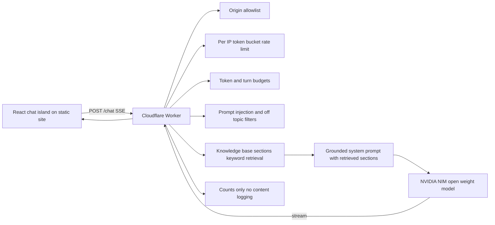

## What it does

- Answers questions about my experience, approach and case studies, grounded only on the knowledge base built from this site.
- **Job-description fit mode**: paste a JD and it maps each requirement to evidence on this site, flags gaps honestly, and links the relevant case studies.
- Suggests reading, offers the booking link or email, and refuses to speculate about anything not in its knowledge base, including compensation.

## Architecture

## Decisions

**Grounding by construction.** The knowledge base is a curated markdown document generated from the site content. Retrieval is section-level keyword matching, which is enough at this size and keeps the system inspectable. The model is told to answer only from the retrieved sections and to say when it does not know.

**The key never reaches the browser.** The Worker holds the NVIDIA key as a secret. The browser only ever talks to the Worker, which allows requests from this site's origin only.

**Abuse controls before features.** Per-IP rate limits, maximum tokens per response, maximum turns per conversation, and message length caps were the first things built. A free-tier service with no controls is an invitation.

**Prompt-injection defense in layers.** Pasted job descriptions are untrusted input. They are wrapped as data, the system prompt reasserts its instructions after them, obvious instruction-override patterns are neutralised, and the model is told to treat any instruction inside user content as text to analyse, not commands to follow.

**No content logging.** The Worker counts requests and errors. It does not store conversations. Recruiters can paste a JD without it being retained.

**Open-weight model on a free tier.** NVIDIA NIM's OpenAI-compatible endpoint serves Llama 3.3 70B at zero cost for this volume. Swapping the model is a one-line config change; the router pattern from my larger platforms is intentionally absent here because a single model is the right size for the job.

## What it is not

It is not a RAG system with a vector database, an agent with tools that act on the world, or a multi-model router. Each of those would be over-engineering for a portfolio assistant. Knowing when not to build the sophisticated version is part of the judgment I am asking you to evaluate.

## Try it

Open the assistant from the button in the corner and ask it something hard, or paste a job description and ask for a fit assessment. Then read the [source](https://github.com/naveenkumar911/naveenkumar911.github.io) if you want to check the controls yourself.
