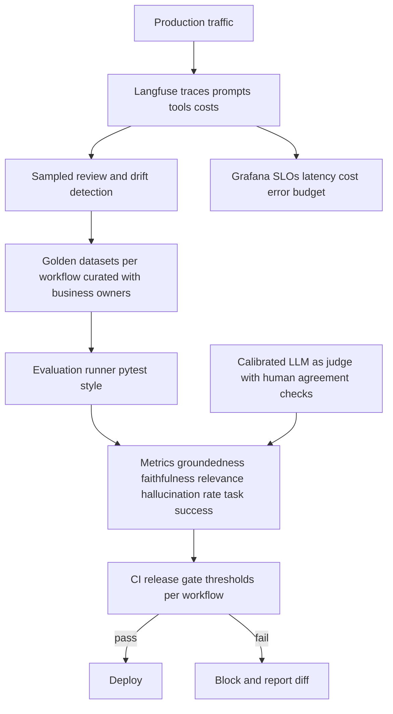

## Why this exists

Every agentic system I have inherited or built had the same failure pattern: prompt and model changes shipped on vibes, quality drifted silently, and nobody could say whether the last change made things better. The harness turns quality into a number the team owns and a gate that releases must pass.

## Design

### Golden datasets

Built with the business owner of each workflow, not by engineers alone. Each item has an input, expected grounded answer or action, required citations, and a difficulty tag. Sets are refreshed from sampled production traces so they keep tracking real usage.

### Metrics

- Groundedness and faithfulness to retrieved context.
- Answer relevance and completeness.
- Hallucination rate (claims without support in context).
- Task success for agentic workflows (did the right tools fire with the right arguments, did the end state match).
- Latency percentiles and cost per request as first-class quality metrics.

### LLM-as-judge, calibrated

Judge prompts are validated against a human-labelled subset until agreement is acceptable; disagreements are reviewed and the rubric refined. Judges are versioned like any other model dependency.

### Release gate

Regression suites run in CI on every prompt, retrieval or model change. Thresholds are per workflow. A failing gate blocks deployment and posts a diff of what changed and which items regressed.

### Observability

Langfuse traces every request end to end: prompts, retrieved chunks, tool calls, model, tokens, cost, latency. Grafana dashboards track SLOs and error budgets. Sampled traces feed weekly quality reviews and become new golden items.

## Key decisions

**Evals as code, in the same repo as the agent.** No separate evaluation team, no dashboard nobody reads. The engineer who changes a prompt sees the regression result in their pull request.

**Business owners own the golden set.** This is what made "accuracy" mean the same thing to the Director and the engineer.

**Cost and latency are quality.** A correct answer that costs three times the budget or arrives after the user has left is a failure. Putting these in the same gate prevented several "better model" changes that would have blown the budget.

## Outcomes

- Answer accuracy up 30-40% and hallucinations down about 30% on the government platform, sustained across model and prompt changes.
- No silent regressions in production since gating was introduced.
- Faster, safer iteration: engineers ship prompt and retrieval changes daily with confidence.
- Reusable harness structure adopted by other squads through the reference architecture and review gates.

## Reuse

The harness structure, judge calibration approach and gate thresholds are documented in the [evaluation methodology](/architecture/evaluation-methodology) and the [governed agent platform reference architecture](/architecture/governed-agent-platform).
