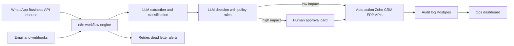

## Problem

Operations teams spent hours a day moving information between WhatsApp conversations with suppliers, the CRM, spreadsheets and the ERP: confirming deliveries, chasing price changes, updating records. The work was repetitive, but every message needed a small judgment call, which is why it had never been automated with rules.

## Approach

Use LLMs for the judgment steps (extract intent and entities from messy messages, classify, decide next action) and n8n for the plumbing (triggers, integrations, retries, state). Keep humans in the loop where money or contracts change.

## Engineering details that made it reliable

- **Idempotency keys** on every external write so retries never duplicate a CRM record or a supplier confirmation.
- **Structured outputs** from the LLM validated against a schema before any action; invalid outputs route to a human queue rather than failing silently.
- **Policy rules around the model**: thresholds for price changes, contract values and new-supplier events force approval regardless of model confidence.
- **Dead-letter handling and alerts** for integration failures; nothing is lost when an API is down.
- **Audit log** of every decision with the extracted fields, model version and approver, which satisfied finance and internal audit.

## Outcomes

- More than 1,000 tasks per month automated across supply chain, pricing and CRM operations.
- Operations staff redeployed to exception handling and supplier relationships.
- Contribution to the $2M per year savings reported for the engagement.

## Why it matters for larger programs

This is the same pattern that scales to enterprise agent platforms: LLM for judgment, deterministic engine for plumbing, policy around the model, audit for trust. Low-code tooling made the first version fast; the design principles are the same ones I apply on Kubernetes-scale platforms.
