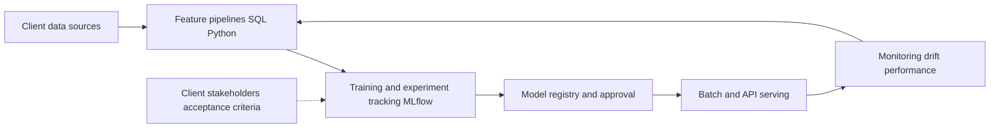

## The pattern

Three very different clients, one delivery pattern: embed with the client team, define requirements and acceptance criteria with the actual stakeholders, build production-grade pipelines rather than notebooks, and leave the client owning the system.

## What I built

- **Forecasting** models and pipelines feeding operational and planning decisions, with backtesting frameworks and drift monitoring.
- **Fraud and anomaly detection** pipelines with feature stores, threshold tuning against business cost curves and analyst feedback loops.
- **Enterprise analytics** pipelines (Python, SQL/PostgreSQL) covering ingestion, feature engineering, training, deployment and monitoring under MLOps practices.

## What regulated clients taught me

- Acceptance criteria written with the business are the only definition of done that survives an audit.
- Reproducibility (versioned data, features, models, code) is a delivery requirement, not an engineering nicety.
- Knowledge transfer is part of the build: documentation, walkthroughs and shadowing so the client team runs the system after you leave.

These habits carried directly into the agentic era: evaluation gates, ADRs and runbooks are the same discipline applied to non-deterministic systems.
