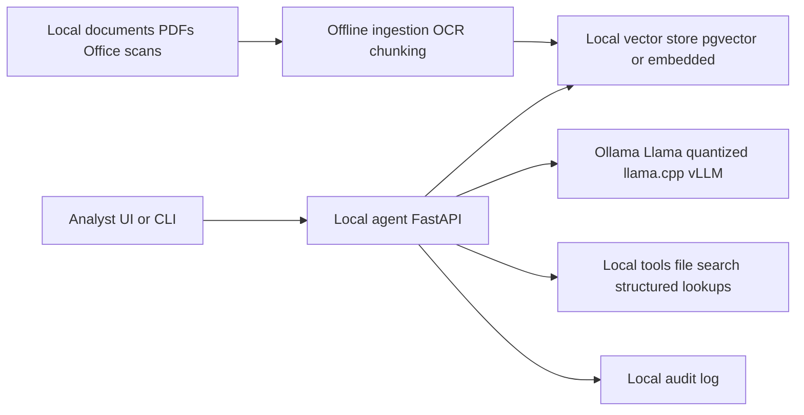

## Why it matters

Some conversations in government and regulated industries end at "the data cannot leave this room". A portfolio of cloud-only patterns fails that test. This agent exists so that grounded document Q&A and light automation can run with zero external dependencies, and so that the larger platforms I design always have a sovereign fallback.

## Design

- Quantized Llama-family models served through Ollama or llama.cpp on CPU or a single GPU; vLLM where a GPU is available and throughput matters.
- Embeddings computed locally; vector store kept on the same host or network segment.
- Agent loop with retrieval, citation and structured tool calls, no outbound network permission at the container level.
- Local audit log of prompts, retrieved chunks and outputs for review.

## Trade-offs I make explicit

- Smaller models mean narrower reasoning; the agent is scoped to grounded Q&A, extraction and routing, not open-ended research.
- Latency is tuned through quantization, prompt caching and short context windows rather than raw model size.
- Evaluation uses the same golden-set approach as the cloud platforms, so quality is measured rather than assumed.

## Where it fits

In the [governed agent platform reference architecture](/architecture/governed-agent-platform), this is the "sovereign tier" behind the model router: workloads tagged as restricted are routed here automatically. In the [data sovereignty article](/insights/data-sovereignty-llm-systems-gulf) I describe how this tier changes procurement and risk conversations with public-sector stakeholders.
